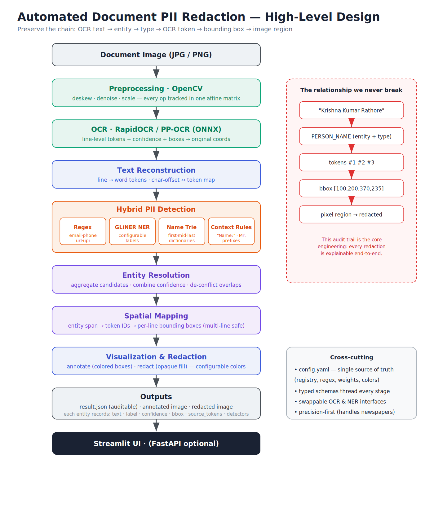

# Automated Document PII Redaction System

> Detects and redacts personally identifiable information (PII) from document images — Aadhaar cards, PAN cards, business cards, even newspaper scans — and maps every detected entity back to its exact pixel region for **auditable** redaction.


-success)

The design goal that drives the whole system:

```
OCR text  →  entity  →  entity type  →  OCR token  →  bounding box  →  image region
```

Every redaction can be traced back through this chain — which detector flagged it, which text it matched, and which pixels were covered. Detecting PII is the easy half; getting the coordinates right and keeping the decision explainable is the hard, interesting half.



## Project status

| Phase | Stage | Status |
|---|---|---|
| 1–2 | Preprocessing + OCR | ✅ Done |
| 3 | Text reconstruction (word tokens, char-offset ↔ token map) | ✅ Done |
| 4 | Regex detection + format validators (email, phone, URL, UPI, date, Aadhaar, PAN, IFSC) | ✅ Done |
| 5 | Name dictionary (trie, fuzzy) + context rules (Name:, Mr., S/O, DOB, A/c No., Aadhaar No.) | ✅ Done |
| 6 | NER model (GLiNER) | ⏳ Next |
| 7 | Entity resolution + spatial mapping | ⏳ |
| 8 | Redaction | ⏳ |
| 9 | Streamlit UI | ✅ Started early: runs every built stage and shows its outputs |

The redacted image is produced **only after a document passes through every stage**. Until then, the CLI and UI show the intermediate outputs of the stages that are built.

---

## Why this project

Organisations handle large volumes of scanned documents containing PII — names, phone numbers, IDs, bank details. Manual redaction doesn't scale and is error-prone, where a **single missed field is a data leak**. Many off-the-shelf tools are black boxes: they hide something, but can't explain *why*, which is a problem in any auditable or regulated setting.

This system aims to **detect PII reliably, redact it on the actual image, and make every decision explainable** — running fully offline on a CPU, so documents never leave the machine.

## Key features

- **Hybrid PII detection** — combines regex, a NER model, name dictionaries (tries), and context rules instead of relying on any single method. Structured data (emails, phones, UPI IDs) and unstructured data (names) are each handled by the technique that suits them.
- **Full audit trail** — `result.json` records, per entity: the text, label, confidence, bounding box(es), source tokens, and which detectors fired. Nothing is a black box.
- **Precision-first** — the system must handle a newspaper as gracefully as an ID card, so name detection requires agreement of multiple signals rather than a single dictionary hit, avoiding a page lit up with false positives.
- **Exact coordinate mapping** — preprocessing (upscale / deskew) is tracked in a single affine matrix and inverted, so every box maps back to the *original* image and redactions land precisely.
- **Configurable by design** — the entity registry, regex patterns, resolver weights, and colours all live in one `config.yaml`. Nothing important is hard-coded.
- **Swappable models** — OCR and NER sit behind interfaces, so backends can be replaced without touching the pipeline.
- **CPU-friendly** — runs a full document in a few seconds on a laptop with no GPU.


## Tech stack

| Component | Choice | Why |
|---|---|---|
| OCR | **RapidOCR + ONNX Runtime** (PP-OCR models) | Lightweight, CPU-fast, painless on Windows (sidesteps heavy PaddlePaddle setup) |
| NER | **GLiNER** (ONNX) | Fast on CPU, and supports configurable labels at inference — fits the configurable entity registry |
| Structured detection | **Regex** + format validators | Aadhaar (Verhoeff checksum), PAN holder type, Indian mobile format, real calendar dates, known UPI handles: a pass boosts confidence, a fail lowers it, and nothing is dropped |
| Name detection | **Custom Trie** | O(length) exact lookups over first / middle / last-name lists, plus edit-distance-1 fuzzy search with branch pruning for OCR slips |
| Image ops | **OpenCV** | Preprocessing, annotation, redaction |
| Config | **YAML** | Single source of truth for all tunables |
| UI | **Streamlit** (FastAPI optional later) | Fast demo UI, backend kept separable |
| Language | **Python 3.9–3.12** | RapidOCR does not support 3.13 yet |

## How it works

1. **Preprocessing (OpenCV)** — upscale small scans, denoise (edge-preserving), and deskew, tracking every geometric change in one affine matrix.
2. **OCR (RapidOCR / PP-OCR)** — produces text lines with confidence and bounding boxes, mapped back to original image coordinates.
3. **Text reconstruction** — splits OCR lines into word tokens with interpolated boxes and builds a character-offset ↔ token map.
4. **Hybrid detection** — regex, GLiNER, name tries, and context rules each emit entity candidates.
5. **Entity resolution** — aggregates overlapping candidates, combines confidence using configurable weights, and de-conflicts.
6. **Spatial mapping** — maps each entity span back through tokens to per-line bounding boxes (multi-line safe).
7. **Output** — annotated image, redacted image, and an auditable `result.json`.


## Getting started

### Prerequisites
- Python 3.9–3.12
- No GPU required

### Installation

```bash
git clone https://github.com/Krishna-Kumar-Rathore/Automated-Document-PII-Redaction-System.git
cd Automated-Document-PII-Redaction-System
python -m venv .venv
# Windows:  .\.venv\Scripts\Activate.ps1
# macOS/Linux:  source .venv/bin/activate
pip install -r requirements.txt
```

> The OCR ONNX models ship inside the `rapidocr-onnxruntime` wheel, so nothing is downloaded at runtime. Everything runs fully offline.

### Web UI

```bash
streamlit run app/ui.py
```

Upload a JPG/PNG (or click **try the synthetic sample**). The page shows each pipeline stage's status and timing, the output images from the completed stages (line boxes, word boxes), the reconstructed text, and a downloadable `result.json`. The **redacted image** appears once every stage is implemented. Uploads are processed in memory and never written to disk.

### Command line

```bash
python -m app.main --image sample.jpg            # --outdir defaults to paths.outputs_dir
```

This produces:
- `outputs/sample.result.json`: stage statuses, OCR lines, reconstructed text, word tokens, entities
- `outputs/sample.ocr_lines.jpg`: OCR line boxes
- `outputs/sample.ocr_words.jpg`: word boxes from text reconstruction
- `outputs/sample.redacted.jpg`: only once the full pipeline is built

### Running tests

```bash
pytest -q
```

## Deploying the UI (Streamlit Community Cloud)

1. Push the repo to GitHub.
2. At [share.streamlit.io](https://share.streamlit.io) choose **New app**, pick the repo and set **Main file path** to `app/ui.py`.
3. Under **Advanced settings**, select **Python 3.11** (any of 3.9–3.12 works).

The repo already contains what the platform needs:
- `requirements.txt`: Python dependencies
- `packages.txt`: `libgl1` and `libglib2.0-0` for OpenCV on Linux
- `.streamlit/config.toml`: 10 MB upload limit, usage telemetry off

The same files work on any Docker or VM host: `streamlit run app/ui.py --server.port 8501`.

> **Privacy note for public deployments:** the app never stores uploads, but the document is still sent to the server that hosts it. For real ID documents, self-host it or keep it private.

## Example output

Line tokens from OCR, then word tokens from text reconstruction. Boxes are in original-image coordinates, and `start`/`end` are offsets into the reconstructed `full_text`:

```json
{
  "ocr":   [{ "id": 2, "text": "Name: Amit Kumar Sharma", "confidence": 0.9974,
              "bbox": [63, 118, 377, 144], "granularity": "line", "start": 18, "end": 41 }],
  "text": {
    "full_text": "...\nName: Amit Kumar Sharma\n...",
    "words": [
      { "id": 3, "text": "Amit",   "bbox": [145, 119, 198, 142], "parent_id": 2, "start": 24, "end": 28 },
      { "id": 4, "text": "Kumar",  "bbox": [206, 119, 280, 143], "parent_id": 2, "start": 29, "end": 34 },
      { "id": 5, "text": "Sharma", "bbox": [288, 120, 377, 144], "parent_id": 2, "start": 35, "end": 41 }
    ]
  }
}
```

A detector that finds `"Amit Kumar Sharma"` at chars 24–41 maps back to word tokens 3–5, and from there to their pixel boxes. The `700×400` sample is upscaled ×1.43 for OCR, yet every box comes back in the original `700×400` space. The affine round-trip is unit-tested, including deskew with canvas expansion.

## Project structure

```
app/
  config/         config.yaml + loader   (single source of truth)
  schemas/        typed data contracts   (OCRToken, ReconstructedText, DocumentResult, EntityCandidate, ResolvedEntity)
  utils/          logging, geometry (affine tracking)
  preprocessing/  deskew / denoise / scale with coordinate tracking
  ocr/            OCREngine interface + RapidOCR implementation
  text/           Phase 3 text reconstruction (reading order, word boxes, offset map)
  detection/      Detector interface; regex + validators (Phase 4);
                  name trie, name detector, context rules (Phase 5)
  visualization/  output image rendering (line/word boxes, entities, redaction)
  pipeline/       DocumentPipeline: runs every stage, reports pending ones
  main.py         CLI entrypoint
  ui.py           Streamlit web UI
data/names/       firstName / middleName / lastName lists
docs/             architecture diagrams (HLD / LLD)
eval/             (planned) labelled test set + precision/recall harness
tests/            unit tests
```

## Design decisions

- **Why hybrid, not just a model?** No single method wins. Regex nails structured entities; a NER model handles unstructured names; dictionaries help but over-fire alone. Combining signals and resolving them is more robust than any one detector.
- **Line-level vs word-level OCR.** PP-OCR detects whole lines, not words. The reconstruction stage splits lines into word tokens with interpolated boxes so a detected span maps to a tight region.
- **Multi-line entities.** Merging all boxes of a multi-line address into one rectangle would over-cover the page; instead each line gets its own box.
- **Coordinate correctness.** All preprocessing transforms are composed into one affine matrix and inverted, so boxes always map to the original image.
- **Validators boost, never gate.** OCR can misread one digit of a genuine Aadhaar number. Dropping it on a failed checksum would leak it, so a failed check only lowers confidence and the resolver decides.
- **OCR-tolerant numbers.** Numeric patterns run on a same-length "digit view" of the text that fixes common confusions (O→0, l→1, S→5, B→8), but only inside digit-heavy chunks. `9OOO0 l2345` is read as a phone number, while words like `BOSS` or `Oct` are left alone, and every match offset still points at the original text.
- **Weighted name signals, not a raw count.** Explicit evidence (a `Name:` label, `Mr.`, `S/O`) scores 2 and a dictionary hit scores 1, with acceptance at 2 or more. `Name: Fooby Barbaz` is caught even though it isn't in any list, `Amit Kumar Sharma` is caught in free text from two dictionary hits, and `Rose Garden` or `Kiran Industries` (one hit) is not. `Company Name: Acme` is rejected by a qualifier list.
- **Labels make generic numbers detectable.** A bare 12-digit number is too ambiguous to flag, but `A/c No. 1234 5678 9012` is clearly an account number. Context rules emit their own candidates, so a `DOB` date found by both regex and a context rule counts as agreement in the resolver.
- **Formatting is evidence.** `080-23456789` and `08023456789` contain the same digits, but the grouping shows the first is a landline (STD code), so the phone validator checks grouping as well as digits.

## Evaluation

A small hand-labelled test set is being built to report **precision / recall / F1 per entity type**, and to tune the resolver's confidence weights against ground truth rather than fixing them arbitrarily. Microsoft Presidio will be used as a benchmark baseline. *(Metrics will be added here as the evaluation phase completes.)*

## Future work

- Handwriting support via a vision-language OCR model
- Layout analysis for structured forms (associate labels with values spatially)
- Confidence calibration on a larger labelled set
- FastAPI service + containerised deployment
- Multilingual support (Hindi / Devanagari)

---

